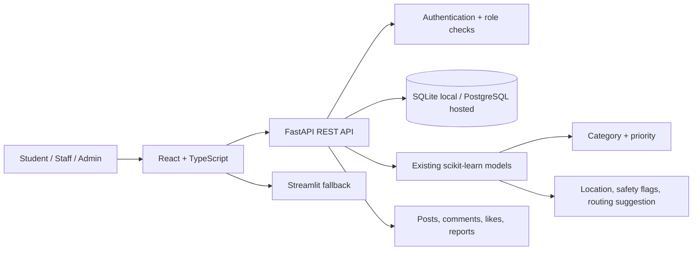

<p align="center">
  <a href="https://git.io/typing-svg">
    
  </a>
</p>

An end-to-end NLP/ML project for classifying complaints, predicting urgency, extracting location, and finding similar previous complaints.

# CampusCare — AI-Powered College Complaint Management

CampusCare upgrades the original Complaint-Classifier prototype while retaining its existing Streamlit app and TF-IDF / Logistic Regression artifacts.

## Project status

This repository now contains an initial full-stack migration foundation. It is **not yet a verified production deployment**. Read the known limitations before using it with real student data.

### Retained from the original prototype
- Streamlit complaint-analysis interface (`app/streamlit_app.py`)
- Scikit-learn TF-IDF + Logistic Regression category and priority models
- Existing model artifacts in `models/`
- Text normalization and pattern-based location extraction
- Cosine-similarity helper
- Training script and synthetic demo CSV
- Original project tests, with the text-cleaning expectation fixed

### Added in this migration foundation
- React + TypeScript + Vite frontend with a responsive, custom CampusCare design system
- Dashboard, complaint submission and tracking, community feed, analytics, notifications, settings, sign-in and registration screens
- FastAPI API with authentication, role checks, complaint persistence, complaint status history, department suggestions, notifications, feedback, community posts, nested comments/replies, likes, content reports, and moderation endpoints
- SQLAlchemy data models with SQLite local development and PostgreSQL URL support
- GitHub Pages workflow and Render service configuration
- API and frontend starter tests
- Environment-variable template

## Architecture



## Repository layout

- `app/`: original Streamlit application, retained
- `src/`: existing preprocessing, classifier, similarity, and training modules
- `data/`: synthetic demo complaints
- `models/`: trained Joblib model artifacts and metadata
- `tests/`: original tests
- `backend/app/main.py`: FastAPI app, database models, endpoints, and service helpers
- `backend/tests/`: API starter tests
- `frontend/src/`: React UI, API client, styles, and frontend starter test
- `.github/workflows/pages.yml`: GitHub Pages workflow
- `backend/render.yaml`: Render service configuration

## Local setup

### 1. Python environment and original model

From the repository root:

```bash
python -m venv .venv
# Windows: .venv\Scripts\activate
source .venv/bin/activate
pip install -r requirements.txt
python -m src.train
```

The training script writes model artifacts and `models/metadata.json`. The included dataset is synthetic and small. Do not interpret its metrics as production-grade model quality.

Run the original Streamlit app:

```bash
streamlit run app/streamlit_app.py
```

### 2. FastAPI backend

Install backend dependencies and start the API from the repository root:

```bash
pip install -r backend/requirements.txt
export SECRET_KEY="$(python -c 'import secrets; print(secrets.token_urlsafe(48))')"
export FRONTEND_ORIGIN="http://localhost:5173"
alembic upgrade head
uvicorn backend.app.main:app --reload --host 127.0.0.1 --port 8000
```

PowerShell environment-variable syntax differs from Bash. On first local run, SQLite tables are created in `backend/app/campuscare.db`. API docs are available at `http://localhost:8000/docs`; health check is `http://localhost:8000/api/health`.

Register a student account through the frontend or `POST /api/auth/register`. Registration intentionally only creates student accounts. After creating an account, a trusted operator can assign an appropriate role from a secured shell: `python -m backend.scripts.set_role user@university.edu admin`. Do not expose this utility as a public endpoint or run it with untrusted database credentials.

### 3. React frontend

```bash
cd frontend
npm install
# Configure VITE_API_BASE_URL=http://localhost:8000 in your build environment
npm run dev
```

The Vite base path is configured for `/Complaint-Classifier/` to match GitHub Pages project-site URLs. For local development, Vite serves the app at its dev URL. If a local route/base mismatch occurs, use `npm run dev -- --base=/`.

## Environment variables

See `.env.example`.

- `DATABASE_URL`: SQLite URL locally, PostgreSQL URL for hosted use
- `FRONTEND_ORIGIN`: comma-separated allowed frontend origins
- `SECRET_KEY`: stable, high-entropy secret for signed sessions; required in production
- `MODEL_PATH`: documented placeholder for future configurable model path (the current predictor uses the repository `models/` directory)
- `VITE_API_BASE_URL`: frontend build-time API origin

Never commit production secrets. Do not use the development fallback signing key in a live service: set `SECRET_KEY` explicitly. Use HTTPS and a persistent database for hosted use.

## API surface

- `GET /api/health`
- `POST /api/auth/register`, `POST /api/auth/login`, `GET /api/auth/me`
- `POST /api/complaints/analyze`, `POST /api/complaints`
- `GET /api/complaints`, `GET /api/complaints/{complaint_id}`, `PATCH /api/complaints/{complaint_id}`
- `GET /api/analytics/overview`, `GET /api/analytics/trends`
- `POST /api/community/posts`, `GET /api/community/posts`, `PATCH/DELETE /api/community/posts/{post_id}`
- `POST/GET /api/community/posts/{post_id}/comments`, `PATCH/DELETE /api/community/comments/{comment_id}`
- `POST/DELETE /api/community/posts/{post_id}/like`
- `POST /api/community/reports`, `GET /api/moderation/reports`, `PATCH /api/moderation/reports/{report_id}`
- `GET /api/notifications`, `PATCH /api/notifications/{notification_id}/read`
- `POST /api/complaints/{complaint_id}/feedback`

FastAPI's OpenAPI page is the most current schema for request and response models.

## Deployment

### Frontend — GitHub Pages
1. Push the repository to the `main` branch.
2. In repository Settings → Pages, select **GitHub Actions** as the publishing source.
3. Add the repository variable `VITE_API_BASE_URL` with the deployed API origin.
4. Ensure the backend CORS allowlist includes the exact GitHub Pages origin.
5. The workflow installs frontend dependencies, runs the frontend test command, builds, and publishes `frontend/dist`.

### Backend — Render
1. Create a Render web service from the repository and use `backend/render.yaml` as a starting point.
2. Set `DATABASE_URL` to a managed PostgreSQL connection string.
3. Set `SECRET_KEY` to a stable random secret.
4. Set `FRONTEND_ORIGIN` to the exact deployed frontend origin.
5. Verify `/api/health`, model loading, database persistence after restart, and access controls before use.

The backend deployment has not been performed or verified by this repository generation. GitHub Pages hosts only the static frontend; it cannot run Python or serve model inference.

## Model behavior and evaluation

- Category and priority predictions use the original saved scikit-learn models.
- Location extraction is pattern-based; it does not infer locations that are not present in the text.
- Sentiment is currently a lightweight keyword heuristic, **not a separately trained or evaluated sentiment model**.
- Potentially critical words (e.g. fire, exposed wire, electric shock, threats) trigger a human-review warning and elevate the created record to Critical. This is a conservative keyword rule, not an emergency detector.
- Category-to-department mappings are initial defaults in `backend/app/main.py`; production administrators still need a secure management interface.
- Similarity helper code is retained, but the current API does not yet expose privacy-filtered similarity results from stored complaint records.

The original saved metadata reports a 12-record holdout evaluation of 8.33% category accuracy and 33.33% priority accuracy. The evaluation is extremely small and likely unstable. Synthetic demo data does not establish real-world accuracy. Collect more anonymized, representative, human-labelled data and evaluate per-class precision/recall/F1 and confusion matrices before relying on predictions.

## Tests

From repository root:

```bash
pytest -q
pytest backend/tests -q
cd frontend && npm test
npm run build
```

Only report test results that have actually been run in your environment. Some test commands require installing backend/frontend dependencies first.

## Security and known limitations

This is an incremental development foundation, not a production-ready deployment. Before real use:
- Replace the custom signed bearer token implementation with a maintained authentication/session library and consider secure HttpOnly cookies.
- Add login/register rate limiting, password reset, account verification, session revocation, and administrator provisioning.
- Review the initial Alembic migration, add explicit column-by-column revisions for future schema changes, and test rollback / production migration procedures.
- Harden moderation (appeals, audit trail, user restrictions), nested-thread depth, anti-spam controls, and attachment storage/validation.
- Implement department/user management screens, staff assignment scopes, admin provisioning, richer analytics/trends, and full audit logging.
- Add persistent complaint similarity search with privacy filtering and model insights/evaluation pages.
- Complete image uploads and safe object storage; the current UI does not upload attachments.
- Add end-to-end workflow tests and test on mobile devices / assistive technologies.
- Configure a production-grade logging, backup, retention, monitoring, and incident-response policy.
- Use HTTPS, explicit CORS origins, stable secrets, managed PostgreSQL, and privacy review before onboarding students.

## License

See `LICENSE`.
